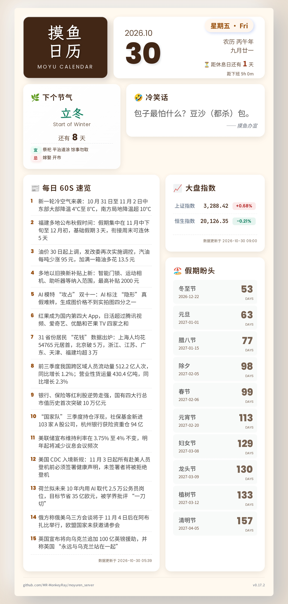

# Moyuren Server

摸鱼日历图片生成服务 | FastAPI + Playwright

## 预览



## API 体验

```bash
https://api.monkeyray.net/api/v1/moyuren
```

## 功能

- 定时生成摸鱼日历图片（支持 daily/hourly 模式）
- 按需生成：启动时缺少有效的当天 JSON 则补建；请求当天数据时若缺少数据则生成，JSON 存在但所选模板图片丢失时仅尝试重新生成该模板（无法确定模板时生成全部），历史数据不触发补图
- 智能缓存管理：
  - 日级缓存：数据源独立缓存，次日自动过期
  - 日级缓存基类与新闻缓存：文件读写在线程中执行，同一服务实例的并发读取串行检查缓存，避免重复抓取；强制刷新仍逐次执行，失败时保留过期缓存降级。新闻仍按内容日期判断新鲜度
  - 启动预热：后台并行预热已启用的日级缓存，再检查当天图片；初始化不阻塞 HTTP 服务启动
  - 降级策略：网络失败时返回过期缓存
  - 自动清理过期图片文件
- 60s-api 数据源公共实例智能切换（新闻、趣味内容、疯狂星期四、金价）
  - 60s 主域名对数据中心/海外出口 IP 会返回 Cloudflare 403，此时自动切换到
    [公共实例](https://docs.60s-api.viki.moe/7306811m0)：四个数据源共用 `instances` 配置，各服务独立缓存发现结果（6 小时）并维护路由健康度：
    优先复用上次成功的实例（粘性），连续失败 2 次的实例降级到最后尝试（10 分钟冷却），单次最多尝试 4 个端点
- 数据源请求与公共实例发现复用应用的 HTTP 客户端和连接池，各自保留请求超时；未注入客户端的独立脚本仍可运行。ECDICT 大文件下载使用独立客户端与长超时
- 60 秒读懂世界新闻
  - 数据源：[60s-api](https://60s.viki.moe)
  - 主源与公共实例均不可用时，继续回退到 60s 静态镜像
    （`cdn.jsdmirror.com` → `60s-static.viki.moe` → GitHub raw → `network.ghproxy_urls` 代理前缀），
    避免新闻长期停留在旧日期
  - 错误信封、空新闻与解析失败均触发后续数据源回退；API 未更新到今天时，按新闻日期保留 API 与本地缓存中较新的数据
- 农历信息与节气（干支年、生肖、二十四节气）
  - 数据源：[tyme4py](https://github.com/6tail/tyme4py)
- 节日倒计时整合（法定假日 + 农历/公历节日）
  - 数据源：[holiday-cn](https://github.com/NateScarlet/holiday-cn)
  - 农历节日按农历年份跨年查询；同名法定假日保留最近一次，普通节日不标记为放假，补班单独展示
  - 年度数据全部获取失败时保留过期聚合缓存；原始年度缓存校验数据格式并原子写入，避免无效响应或写入中断破坏缓存
- 趣味内容随机展示（冷笑话、一言、段子、摸鱼语录）
  - 数据源：[60s-api](https://60s.viki.moe)，支持公共实例智能切换
- 疯狂星期四：每周四自动展示 KFC 文案
  - 数据源：[60s-api](https://60s.viki.moe)，支持公共实例智能切换
- 大盘指数行情（上证、深证、创业板、恒生、道琼斯；短时缓存）
  - 数据源：[东方财富](https://www.eastmoney.com)
  - 交易日历：[exchange_calendars](https://github.com/gerrymanoim/exchange_calendars)
- 每日金价查询（今日金价与卖出价，默认单位元/克）
  - 数据源：[60s-api](https://60s.viki.moe)，支持公共实例智能切换
- 每日英语单词（ECDICT 词典 + 随机 API）
  - 数据源：[ECDICT](https://github.com/skywind3000/ECDICT) + `random-word-api.herokuapp.com`，API 连续失败时回退词典随机选词
- 周/月/年进度百分比计算
- 多模板渲染：自动发现与热加载 HTML 模板，meta 标签描述渲染参数；支持鉴权预览，部分模板失败不影响其他模板
- 本地 WOFF2 字体、节日/四季主题、调休感知的休息日与下班倒计时
- JPEG 原图及可选 WebP、缩小变体，支持按格式和宽度获取
- Playwright 高质量浏览器渲染
  - Chromium 崩溃或断连后在下一次请求时重启，创建页面遇到浏览器关闭错误时重试一次
- RESTful API + 静态文件服务
- Prometheus 可观测性：生成/模板渲染耗时、数据源获取结果与实例健康指标始终记录；`metrics.enabled` 默认关闭，仅控制 `/metrics` 端点是否对外提供
- 生成成功通知：按触发来源将图片推送到企业微信、飞书、钉钉、Telegram 或通用 JSON Webhook；支持模板筛选、签名及每日去重
- 数据新鲜度：新闻日期与本次生成的业务日期不一致，或任一数据源使用过期缓存时，图片显示轻量提示；详情 JSON 返回 `is_stale` 和 `source_date`，旧数据文件仍兼容
- RSS 2.0 图片订阅源，支持模板筛选与条件请求
- 静态发布到 Cloudflare Pages（GitHub Actions 定时推送）
- YAML 配置 + 环境变量覆盖

## 快速开始

### 环境要求

- Python >= 3.12（CI 与 Docker 使用 3.12），以及 Playwright Chromium 所需的系统库

### 本地运行

```bash
# 安装依赖
pip install -r requirements.txt
playwright install chromium

# 启动服务
uvicorn app.main:app --reload
```

服务地址：http://127.0.0.1:8000

### Docker 运行

```bash
docker compose up -d
```

容器配置覆盖使用 `MOYUREN_` 前缀，例如 `MOYUREN_SERVER_HOST=0.0.0.0`、`MOYUREN_SERVER_PORT=8000`、`MOYUREN_SERVER_BASE_DOMAIN=https://example.com`、`MOYUREN_OPS_API_KEY=...`；端口映射需与监听端口一致。无前缀名称不会参与配置覆盖。

原子写入的图片、变体、数据 JSON 和缓存文件权限遵循进程启动时的 umask（`0666 & ~umask`；通常 umask 为 `0022`，文件权限为 `0644`）。`docker-entrypoint.sh` 不设置 umask，也不读取 `UMASK` 环境变量；它在 root 启动时初始化 `/app/cache` 的属主后通过 `gosu` 切换到 `appuser`，否则直接执行服务。需要更严格权限时，应在启动 Python 服务前设置进程 umask。

如遇挂载目录权限问题（镜像默认 UID/GID 为 1000，可通过构建参数修改）：

```bash
mkdir -p cache logs
sudo chown -R 1000:1000 cache logs
```

## 依赖管理

`requirements.txt` 和 `requirements-dev.txt` 保留依赖最低版本，并限制在下一个主版本之前（Ruff 和 mypy 按次版本限制）。`.github/dependabot.yml` 配置 Dependabot 每周向 `develop` 提交 Python 依赖、GitHub Actions 和 Docker 基础镜像更新；Python 次版本/补丁更新合并为一个 PR，主版本升级单独评审。

## 开发与测试

CI 在运行测试前执行 Ruff 代码检查（含日志惰性格式化规则 G004）和 mypy 类型检查。本地安装运行依赖和开发依赖（`pip install -r requirements.txt -r requirements-dev.txt`）后可运行：

```bash
ruff check app tests scripts
mypy app
coverage run -m pytest -m "not e2e" --tb=short
coverage report --fail-under=75
```

CI 另外生成覆盖率 XML，并在 PR 中运行非阻塞的 diff-cover（变更行阈值 80%）。

## API

| 方法 | 路径 | 说明 |
| ---- | ---- | ---- |
| GET/HEAD | `/healthz` | 健康检查 |
| GET/HEAD | `/readyz` | 就绪检查（启动进度、当天数据与浏览器状态） |
| GET | `/metrics` | Prometheus 文本指标（`metrics.enabled=true` 时可用，否则 404） |
| GET | `/api/v1/moyuren` | 统一端点：图片元信息/详情/文本/Markdown/图片；详情包含数据新鲜度 |
| GET/HEAD | `/api/v1/feed.xml` | 最近每日图片的 RSS 2.0 订阅源（`feed.enabled=true` 时可用） |
| GET | `/api/v1/templates` | 获取支持的模板列表 |
| POST | `/api/v1/ops/generate` | 手动触发图片生成（需鉴权） |
| POST | `/api/v1/ops/cache/clean` | 清理过期缓存（需鉴权） |
| POST | `/api/v1/ops/templates/preview` | 模板开发预览，直接返回 JPEG（需鉴权） |
| GET/HEAD | `/static/{filename}` | 静态图片文件 |

> 除 Ops 外，上表端点均不要求 API Key。当天缺少数据或已知模板原图时按需生成；历史数据不补图。同进程请求共享生成任务，未覆盖的模板可能继续生成。其他进程占锁（等待最多 5 秒）或等待已有任务超过 90 秒时返回 `503 GENERATION_5002`；`Retry-After` 为图片 API 5 秒、Ops 生成 10 秒。Ops 仅支持 POST。

启用 `metrics.enabled` 后，`GET /metrics` 导出专用注册表中的以下指标（不出现在 OpenAPI 中）：

| 指标 | 标签 | 说明 |
| ---- | ---- | ---- |
| `moyuren_generation_duration_seconds` | `result=success\|partial\|failure` | 整次共享生成任务的耗时；部分模板失败为 partial，所有模板失败为 failure |
| `moyuren_render_duration_seconds` | `template` | 每个模板的渲染耗时，包含失败尝试 |
| `moyuren_source_fetch_total` | `source`, `result=cache\|fresh\|stale\|failed` | source 为缓存命名空间；有效缓存命中、新获取、旧缓存降级、无可用数据（股票为占位数据）分别计数 |
| `moyuren_notify_total` | `webhook`, `result=success\|failure\|skipped` | 每个 Webhook/模板的最终通知结果，重试不重复计数 |
| `moyuren_instance_consecutive_failures` | `endpoint` | 实例最近报告的连续失败次数 |
| `moyuren_instance_cooling_down` | `endpoint` | 实例最近健康更新时是否冷却（0/1） |
| `moyuren_build_info` | `version` | 应用版本，值为 1 |

实例标签仅保留 `scheme://host[:port]`，移除凭据、路径与查询参数；同一源地址由最近一次健康更新覆盖。新闻 API 数据被接受时计为 fresh，即使内容日期并非当天；因 API 日期未知或较旧而保留旧缓存时计为 stale。指标仅保存在当前进程内，重启后重新累计。

### RSS 订阅源

`GET /api/v1/feed.xml` 返回 RSS 2.0 XML，按日期从新到旧列出最近的每日 JPEG 图片。可选 `template` 参数选择模板，省略时使用默认模板；可选 `limit` 参数限制条目数，默认 `feed.max_items`，范围为 1 到该上限，越界或非整数返回 `422`；未知模板返回 `404 API_7004`。条目包含图片链接、由模板/日期/生成时间组成的 GUID、RFC 822 发布时间，以及带图片、农历、前 5 条新闻和过期数据提示的 HTML 描述。仅在图片文件存在且可读取大小时添加 JPEG enclosure；图片缺失仍保留条目。无可用数据时返回空订阅源；无效数据文件和没有所选模板图片映射的数据会被跳过。

订阅源支持 `HEAD`、`ETag`、`Last-Modified`、`If-None-Match` 和 `If-Modified-Since` 条件请求，缓存策略为 `public, max-age=300, must-revalidate`。设置 `feed.enabled=false` 后端点返回 `404 {"detail":"Not Found"}`，优先于查询参数校验。

### 数据流

定时任务、启动补建或当天 API 请求 → 共享生成任务与跨进程文件锁 → 并行读取各数据源缓存/网络数据 → `DataComputer` 计算日历、主题、倒计时与新鲜度 → Jinja2 + Playwright 逐模板渲染 JPEG → Pillow 生成可选变体 → 原子更新每日 JSON。生成后后台清理缓存并按配置发送 Webhook；API、静态文件与 RSS 读取已有产物。

### 静态发布

通过 GitHub Actions 每 30 分钟自动生成摸鱼日历图片及结构化数据，推送到独立仓库 [moyuren-pages](https://github.com/monkeyray/moyuren-pages)，由 Cloudflare Pages 托管。

**静态站点地址**：https://moyuren.pages.dev

**可用格式**：

| 路径 | 说明 |
| ---- | ---- |
| `/latest.json` | 最新数据（JSON） |
| `/latest.jpg` | 最新图片 |
| `/latest.txt` | 最新纯文本 |
| `/latest.md` | 最新 Markdown |
| `/history.json` | 可用日期列表 |
| `/{date}/data.json` | 指定日期数据 |
| `/{date}/moyuren.jpg` | 指定日期图片 |
| `/{date}/data.txt` | 指定日期纯文本 |
| `/{date}/data.md` | 指定日期 Markdown |

**相关文件**：

- `scripts/publish_static.py` — 静态产物生成脚本
- `.github/workflows/publish-static.yml` — 定时发布 workflow

### 端点详情

<details>
<summary>GET /healthz - 健康检查</summary>

返回服务健康状态，支持 GET 和 HEAD 方法。

**响应示例**：

```json
{
  "status": "ok"
}
```

</details>

<details>
<summary>GET /readyz - 就绪检查</summary>

验证服务是否可以处理请求，支持 GET 和 HEAD 方法。启动阶段的网络缓存预热和初始图片生成在后台依次执行，不阻塞 HTTP 服务启动；浏览器预热由单独的后台任务执行。

检查项包括配置是否已加载（`config`）、缓存与数据目录是否存在（`cache_dir`）、后台启动任务状态（`startup`）、当天业务日期的数据文件是否存在（`today_data`）以及浏览器是否已连接（`browser`）。配置或缓存目录缺失、或后台启动任务仍为 `starting` 时返回 HTTP `503` 和 `not_ready`。启动任务结束后返回 HTTP `200`：当天数据与浏览器都可用时状态为 `ready`，否则为 `degraded`，API 仍可通过按需生成提供服务。

**响应示例**：

```json
{
  "status": "ready",
  "checks": {
    "config": true,
    "cache_dir": true,
    "startup": "ready",
    "today_data": true,
    "browser": true
  }
}
```

</details>

<details>
<summary>GET /api/v1/moyuren - 统一端点</summary>

获取摸鱼日历数据，支持多种输出格式和查询参数。

**查询参数**：

| 参数 | 类型 | 默认值 | 说明 |
| ---- | ---- | ------ | ---- |
| `date` | string | 业务时区今天 | 目标日期（YYYY-MM-DD），无效日期返回 `400 API_7001` |
| `encode` | string | `json` | 输出格式：`json`、`url`、`text`、`markdown`、`image` |
| `template` | string | 首个可用 | 模板名称 |
| `detail` | boolean | `false` | 是否返回详细字段（仅 encode=json） |
| `format` | `jpeg` / `webp` | `jpeg` | `encode=image/url` 的图片格式；须在 `output_formats` 中启用 |
| `width` | 正整数 | 原图宽度 | `encode=image/url` 的目标绝对像素宽度 |

**输出格式**：

- `encode=json`：JSON 元数据（精简或详细）
- `encode=text`：纯文本格式
- `encode=markdown`：Markdown 格式
- `encode=image`：直接返回 JPEG 或 WebP 图片文件，使用对应的 `image/jpeg` / `image/webp`
- `encode=url`：返回所选图片的绝对 URL（纯文本）

`detail` 仅对 JSON 生效；其他输出忽略该值。`format` 或 `width` 用于其他输出时返回 `400 API_7003`，非法格式、非正整数宽度及无效布尔值返回 FastAPI `422`。

图片选择使用指定格式；不指定 `width` 时返回完整尺寸。指定宽度时，从原图宽度、配置宽度及该格式已记录的宽度中选择大于等于请求值的最小宽度，全部不足时选择最大宽度。宽度是最终图片的绝对像素，与 `device_scale_factor` 无关，不放大图片。禁用格式返回 `400 API_7003`。已配置变体缺失时，从原始 JPEG 在线程中原子补建，GET 不修改数据 JSON；当天原始 JPEG 缺失时按需生成，繁忙返回 `503` 与 `Retry-After: 5`；历史缺图返回 `404 STORAGE_4003`。JSON 精简及详情响应均增加 `variants: [{image: "绝对 URL", format: "jpeg|webp", width: 600}]`，旧文件默认为空列表。

每次 JPEG 渲染成功后生成变体，单个变体失败仅记录警告；数据文件仅记录成功存在的文件。命名为 `<stem>.webp`、`<stem>_w<width>.jpg` 和 `<stem>_w<width>.webp`。Pillow 使用 LANCZOS 缩小、保留宽高比、移除派生文件元数据，以临时文件和 `os.replace` 原子写入；缩小 JPEG 使用 `jpeg_quality`，WebP 使用 `webp_quality`。

**HTTP 缓存**：

- 历史日期（< 今天）：`Cache-Control: public, max-age=31536000, immutable`
- 当天数据：`Cache-Control: public, max-age=300, must-revalidate`、`ETag` + `Last-Modified`，支持 `304 Not Modified`。`If-None-Match` 支持逗号分隔列表、`*` 和弱验证器比较；该请求头存在时优先处理并忽略 `If-Modified-Since`。`Last-Modified` 按秒精度比较，回传服务端返回值可正确命中缓存

图片变体的 ETag 包含格式、最终宽度和文件名身份；图片及 URL 响应的 `If-Modified-Since` 单独出现时保守返回 200，请使用 ETag 进行 304 校验，避免不同变体共享生成时间导致误命中。参数显式选择格式，不使用 `Accept` 内容协商。

**精简响应示例**（`encode=json`）：

```json
{
  "date": "2026-02-06",
  "updated": "2026/02/06 18:53:17",
  "updated_at": 1770375197567,
  "image": "https://api.monkeyray.net/static/moyuren_20260206_185317.jpg",
  "variants": [
    {"image": "https://api.monkeyray.net/static/moyuren_20260206_185317.jpg", "format": "jpeg", "width": 2382}
  ]
}
```

**详细响应**（`encode=json&detail=true`）包含精简响应的所有字段，以及：weekday、lunar_date、fun_content、is_crazy_thursday、kfc_content、date_info、weekend、solar_term、guide、news_list、news_meta、holidays、kfc_content_full、stock_indices、gold_price、is_stale、source_date。`gold_price` 为 `{today_price,sell_price,unit}` 金价数据对象或 `null`；股票完全获取失败时 `stock_indices` 还带 `is_data_missing: true`。`daily_english`、`theme`、`next_rest_day`、`off_work` 不在当前详情输出中。

`is_stale` 为已知新闻日期不等于生成时业务日期，或任一源使用过期缓存的标志；股票旧缓存计入，完全失败的占位数据不计入。`source_date` 为规范化的新闻日期（`YYYY-MM-DD`），未知时为 `null`。旧文件的详情默认 `is_stale=false`、`source_date=null`。模板仅在过期时显示提示：新闻非当日时显示“数据日期 YYYY-MM-DD（非当日）”，其余情况（新闻为当日但其他源使用缓存）显示“部分数据为缓存”。生成日期、写入时间与数据来源日期分别保留。

详细字段说明参见 [Pydantic 模型](app/models/schemas.py) 中的 `MoyurenDetailResponse`。

</details>

<details>
<summary>GET /api/v1/templates - 模板列表</summary>

获取支持的模板列表及当前图片 URL。

**响应示例**：

```json
{
  "data": [
    {
      "name": "moyuren",
      "description": "杂志风格版摸鱼日历，清晰呈现日期、热点与生活信息。",
      "image": "https://api.monkeyray.net/static/moyuren_20260210_072232.jpg",
      "show_daily_english": false
    },
    {
      "name": "moyuren_cute",
      "description": "棉花糖波普版摸鱼日历，以明快可爱的卡片展示每日信息。",
      "image": "https://api.monkeyray.net/static/moyuren_cute_20260210_072232.jpg",
      "show_daily_english": true
    }
  ]
}
```

没有查询参数。`image` 为当天 JSON 中记录的图片 URL，无映射时为 `null`，不触发补图或检查文件是否存在。`show_daily_english` 反映模板元数据，默认 `true`（内置主模板为 `false`，可爱模板为 `true`）。

**缓存**：`Cache-Control: public, max-age=300, must-revalidate`。`description` 来自 HTML 的 `moyuren:description` meta，去除首尾空白、截断至 200 字符；未提供时为 `null`。模板变动由服务端热加载，客户端缓存仍可保留 300 秒。

</details>

<details>
<summary>POST /api/v1/ops/* - 运维端点（需鉴权）</summary>

所有 Ops 端点仅支持 POST，需要 `Authorization: Bearer <api_key>` 请求头；`ops.api_key` 留空则禁用 ops 端点。由处理器返回的响应带 `Cache-Control: no-store`；鉴权失败同时带 `WWW-Authenticate: Bearer`。GET 请求返回 `405 Method Not Allowed`，不会生成图片或清理缓存。

**POST /api/v1/ops/generate** - 手动触发图片生成

无请求体或查询参数。成功响应包含本次成功/复用的模板文件名 `results`、配置模板总数 `total_templates`、当天持久化图片映射 `images` 以及业务日期 `date`；部分模板失败仍返回 `200`，全部失败返回 `500 GENERATION_5001`：

```json
{
  "data": {
    "date": "2026-02-10",
    "results": {
      "moyuren": "moyuren_20260210_072232.jpg",
      "moyuren_cute": "moyuren_cute_20260210_072232.jpg"
    },
    "total_templates": 2,
    "images": {
      "moyuren": "moyuren_20260210_072232.jpg",
      "moyuren_cute": "moyuren_cute_20260210_072232.jpg"
    }
  }
}
```

**POST /api/v1/ops/cache/clean** - 清理过期缓存

可选查询参数 `keep_days: int | null`，默认使用 `cache.retain_days`，POST 也通过 URL 传递。非正数返回 `400 API_7003`，非整数返回 `422`。成功返回 `{"data":{"deleted_files":3,"freed_bytes":12345,"oldest_kept":"2026-10-01","pruned_images":1}}`；清理失败为 `500 OPS_8001`。

**POST /api/v1/ops/templates/preview** - 模板预览

JSON 请求体：`{"template": "moyuren", "date": "2026-10-29", "data": "sample"}`。`template` 必填且必须已发现；`date` 可省略或为 `null`，默认为业务时区今天，严格使用 `YYYY-MM-DD`，按该日业务时间 09:00 计算上下文。`data` 可为 `cached`（默认）或 `sample`。

`cached` 仅通过日级缓存的 `load_cache()` 读取已有磁盘文件（news、holidays、fun_content、kfc、gold_price、daily_english），不检查过期后抓取、不联网、不写缓存；新闻按键合并，缺失或类型无效的来源逐项回退内置样例。过期磁盘数据也可预览；股票当前只有进程内缓存，因此始终使用样例。`sample` 使用与日期确定对应的内置离线数据，无需任何数据源服务。

成功直接返回 `200 image/jpeg` 和 `Cache-Control: no-store`，不写 images/data JSON，不更新正式生成指标，不发送通知，不占用正式生成锁。预览每个应用进程只允许一个渲染；等待超过 `ops.preview_wait_timeout_sec`（默认 2 秒）返回 `503 GENERATION_5002`、`Retry-After: 2`。使用正式渲染器的视口、质量、资源策略与加载/字体/截图超时；预览不写远程资源缓存。数据源访问完全离线；浏览器仍可按配置加载远程字体，离线环境可关闭 `remote_font_fallback` 并使用本地资源。

未知模板返回 `404 API_7004`，无效日期/数据模式或缺少必填字段返回 `422`，鉴权失败返回 `401 AUTH_6001`，渲染失败返回 `500 GENERATION_5001`。

```bash
curl -X POST http://localhost:8000/api/v1/ops/templates/preview \
  -H "Authorization: Bearer $MOYUREN_OPS_API_KEY" \
  -H 'Content-Type: application/json' \
  -d '{"template":"moyuren","data":"sample","date":"2026-10-29"}' \
  --output /tmp/moyuren-preview.jpg
```

**鉴权失败响应**（401）：

```json
{
  "error": {
    "code": "AUTH_6001",
    "message": "无效的 API Key"
  }
}
```

</details>

<details>
<summary>错误响应格式</summary>

业务错误使用以下格式。FastAPI 请求校验错误为 `422 {"detail":[...]}`；禁用的 metrics/feed、静态文件缺失以及未匹配的路由使用框架的 `{"detail":...}` 格式。

**响应示例**：

```json
{
  "error": {
    "code": "STORAGE_4003",
    "message": "No image available"
  }
}
```

**常见错误码**：

| HTTP 状态码 | 错误码 | 说明 |
| ----------- | ------ | ---- |
| 400 | `API_7001` | 无效的日期格式 |
| 400 | `API_7002` | 无效的 encode 参数 |
| 400 | `API_7003` | 无效的请求参数 |
| 401 | `AUTH_6001` | 未授权（API Key 无效） |
| 404 | `API_7004` | 模板不存在 |
| 404 | `API_7005` | 数据不存在 |
| 404 | `STORAGE_4003` | 无可用图片 |
| 400 / 500 | `STORAGE_4002` | 非法图片路径 / 数据文件读取或校验失败 |
| 422 | 无业务错误码 | 查询参数或预览请求体校验失败（`detail` 数组） |
| 500 | `RENDER_3003` | 原图无法读取尺寸 |
| 500 | `GENERATION_5001` | 图片生成或预览失败 |
| 500 | `OPS_8001` | 缓存清理失败 |
| 503 | `GENERATION_5002` | 生成或预览繁忙；Retry-After 为图片 API 5 秒、Ops 生成 10 秒、预览 2 秒 |

</details>

## 配置

配置文件：`config.yaml`

### 0.18.2 旧部署升级注意事项

- 配置覆盖统一使用 `MOYUREN_` 前缀；例如将 `SERVER_PORT` 改为 `MOYUREN_SERVER_PORT`，否则继续使用 YAML 或默认值。
- Ops 生成和缓存清理改用同一路径的 POST，GET 不再支持。
- 股票指数使用 `{secid: "1.000001", name: "上证指数", market: "A"}` 对象；节假日不再接受 `mirror_urls`，代理统一配置 `network.ghproxy_urls`。
- 词典相对路径从缓存根目录开始，例如 `ecdict/stardict.db`；旧值 `cache/ecdict/stardict.db` 需移除开头的 `cache/`，避免拼接为双重缓存目录并重新下载词库。
- 仅含节假日列表的日缓存不再转换为缺少补班日期的对象，下次获取时重新构建。年度原始缓存、历史图片和每日 JSON 不删除；无可用年度缓存且网络失败时，旧列表缓存不能用于降级。
- 内部新闻获取统一调用 `DataFetcher.fetch()`；已移除 `fetch_all()`，新闻计算只接受 `{"news": {"data": {"news": [...]}}}` 信封结构。

### 配置项与环境变量

下表列出模型默认值；“必填”表示模型没有默认值。仓库的 `config.yaml` 另外指定了 `scheduler.mode: hourly`、`logging.file: logs/app.log`、GitHub 代理和公共实例发现地址等值，不能与模型默认值混淆。顶层 `server`、`paths`、`scheduler`、`cache`、`templates`、`data_sources`、`logging` 必须提供；其他组可以省略并采用模型默认值。

覆盖优先级为进程环境 → 当前工作目录的 `.env` → `config.yaml` → 模型默认值。环境变量不区分大小写，以 `MOYUREN_` 开头，只将配置组后的第一个 `_` 作为嵌套分隔符：`MOYUREN_METRICS_ENABLED` → `metrics.enabled`，`MOYUREN_CACHE_MAX_IMAGES_PER_TEMPLATE_PER_DAY` → `cache.max_images_per_template_per_day`。允许的名字仅为顶层组名及组内直接字段；更深的逐字段名称会被忽略。

对象和列表用 JSON 字符串覆盖：如 `MOYUREN_TEMPLATES_CONFIG='{"output_formats":["jpeg","webp"]}'`、`MOYUREN_DATA_SOURCES='[{"type":"holiday"}]'`、`MOYUREN_NOTIFY_WEBHOOKS='[]'`；也可用 `MOYUREN_TEMPLATES` 等整体对象。对象与低优先级配置合并，列表整体替换，不支持按索引覆盖。以下子字段表统一通过其所属对象或列表设置，没有独立的深层环境变量。

无前缀名称（如 `SERVER_PORT`）和未知名称会被忽略；配置覆盖必须使用 `MOYUREN_` 前缀。Webhook 的 `url_env` / `secret_env` 是额外引用**进程环境**中的任意名称，不会读取仅存在于 `.env` 的值。

| 配置项 | 模型默认值 | 环境变量 | 说明 |
| --- | --- | --- | --- |
| `server.host` | 必填；YAML 为 `0.0.0.0` | `MOYUREN_SERVER_HOST` | 容器启动脚本的监听地址覆盖；本地 uvicorn 由命令行决定监听地址 |
| `server.port` | 必填；YAML 为 `8000` | `MOYUREN_SERVER_PORT` | 容器监听端口；本地 uvicorn 用 `--port` 指定 |
| `server.base_domain` | 必填；YAML 为 `http://127.0.0.1:8000` | `MOYUREN_SERVER_BASE_DOMAIN` | 图片、RSS 与通知的公开 URL 前缀 |
| `paths.cache_dir` | `cache` | `MOYUREN_PATHS_CACHE_DIR` | 缓存根目录 |
| `scheduler.mode` | `daily` | `MOYUREN_SCHEDULER_MODE` | `daily` / `hourly`；仓库 YAML 使用 `hourly` |
| `scheduler.daily_times` | `["06:00"]` | `MOYUREN_SCHEDULER_DAILY_TIMES` | 业务时区时间列表；daily 模式不能为空 |
| `scheduler.minute_of_hour` | `0` | `MOYUREN_SCHEDULER_MINUTE_OF_HOUR` | 每小时触发分钟，0–59 |
| `cache.retain_days` | `30` | `MOYUREN_CACHE_RETAIN_DAYS` | 正整数，缓存保留天数 |
| `cache.max_images_per_template_per_day` | `3` | `MOYUREN_CACHE_MAX_IMAGES_PER_TEMPLATE_PER_DAY` | 正整数，每模板每天原始 JPEG 数量上限 |
| `ops.api_key` | `""` | `MOYUREN_OPS_API_KEY` | 留空则禁用 ops 端点，处理器鉴权返回 401 |
| `ops.preview_wait_timeout_sec` | `2.0` | `MOYUREN_OPS_PREVIEW_WAIT_TIMEOUT_SEC` | 有限正数，预览并发锁等待秒数 |
| `metrics.enabled` | `false` | `MOYUREN_METRICS_ENABLED` | 是否提供 `/metrics`；指标记录始终开启 |
| `feed.enabled` | `true` | `MOYUREN_FEED_ENABLED` | 是否提供 RSS；关闭时 404 |
| `feed.max_items` | `7` | `MOYUREN_FEED_MAX_ITEMS` | RSS 条目上限，1–60 |
| `notify.enabled` | `false` | `MOYUREN_NOTIFY_ENABLED` | 启用通知；还需非空 webhooks 才创建通知服务 |
| `notify.once_per_day` | `true` | `MOYUREN_NOTIFY_ONCE_PER_DAY` | 同一业务日、Webhook、模板成功后去重 |
| `notify.triggers` | `["scheduled"]` | `MOYUREN_NOTIFY_TRIGGERS` | `scheduled` / `manual` / `startup` 列表 |
| `notify.timeout_sec` | `10.0` | `MOYUREN_NOTIFY_TIMEOUT_SEC` | 正数，单次请求超时秒数 |
| `notify.webhooks` | `[]` | `MOYUREN_NOTIFY_WEBHOOKS` | Webhook 对象列表，字段见下表 |
| `logging.level` | `INFO` | `MOYUREN_LOGGING_LEVEL` | DEBUG / INFO / WARNING / ERROR / CRITICAL |
| `logging.file` | `""`；YAML 为 `logs/app.log` | `MOYUREN_LOGGING_FILE` | 空值只输出到标准输出 |
| `timezone.business` | `Asia/Shanghai` | `MOYUREN_TIMEZONE_BUSINESS` | 业务日历与调度时区；IANA 名或 UTC 偏移 |
| `timezone.display` | `local` | `MOYUREN_TIMEZONE_DISPLAY` | 时间戳展示时区，额外接受 `local` |
| `network.proxy_url` | `null` | `MOYUREN_NETWORK_PROXY_URL` | HTTPX 与 Playwright 共用；支持带认证的 HTTP 代理、无认证 SOCKS5；拒绝 SOCKS 认证 |
| `network.ghproxy_urls` | `[]` | `MOYUREN_NETWORK_GHPROXY_URLS` | GitHub 代理前缀列表；HTTP(S)，不带 query/fragment |
| `instances.list_url` | `null`；YAML 指向 60s 实例文档 | `MOYUREN_INSTANCES_LIST_URL` | Markdown 自动发现地址，null 关闭发现 |
| `instances.urls` | `null`；YAML 为 `[]`（归一化后 null） | `MOYUREN_INSTANCES_URLS` | 可信实例基地址列表，优先于发现结果 |
| `instances.allowlist` | `null` | `MOYUREN_INSTANCES_ALLOWLIST` | 仅筛选发现实例；null 不筛选，[] 全部拒绝 |
| `templates.default` | `null`；YAML 为 `moyuren` | `MOYUREN_TEMPLATES_DEFAULT` | 渲染/RSS 默认模板；未指定时退回首个模板，moyuren API 则取当日图片映射首项 |
| `templates.dir` | `templates` | `MOYUREN_TEMPLATES_DIR` | HTML 模板目录，相对进程工作目录 |
| `templates.hot_reload` | `true` | `MOYUREN_TEMPLATES_HOT_RELOAD` | 模板发现热加载 |
| `templates.hot_reload_interval_sec` | `5.0` | `MOYUREN_TEMPLATES_HOT_RELOAD_INTERVAL_SEC` | 有限正数，目录指纹检查间隔秒数 |
| `templates.config` | 下表中的渲染默认值 | `MOYUREN_TEMPLATES_CONFIG` | 全局渲染对象，可用 JSON 部分覆盖 |
| `templates.items` | `[]` | `MOYUREN_TEMPLATES_ITEMS` | 运行时发现的模板项，通常由 HTML meta 生成；序列化配置时排除 |
| `data_sources` | 必填 | `MOYUREN_DATA_SOURCES` | 下表的数据源列表，同一 type 不可重复；缺少 holiday 时自动补默认项 |

渲染字段均通过 `MOYUREN_TEMPLATES_CONFIG` JSON 覆盖：

| 配置项（`templates.config.*`） | 模型默认值 | 说明 |
| --- | --- | --- |
| `device_scale_factor` | `3` | 正整数，设备缩放因子 |
| `jpeg_quality` | `100` | JPEG 质量，1–100 |
| `output_formats` | `["jpeg"]` | jpeg / webp，不重复且必须包含 jpeg |
| `output_widths` | `[]` | 不重复的正整数，最终绝对像素宽度；只生成小于原图的宽度 |
| `webp_quality` | `85` | 整数，1–100 |
| `use_china_cdn` | `true` | 远程字体使用大陆 CDN；false 使用国际 CDN |
| `local_fonts_dir` | `templates/fonts` | 本地字体目录，相对进程工作目录 |
| `remote_font_fallback` | `true` | 是否启用 Google Fonts 缺字回退 |
| `work_end_time` | `"18:00"` | 业务时区下班时间，严格 HH:MM |
| `remote_resource_cache_enabled` | `true` | 远程资源磁盘缓存开关 |
| `remote_resource_cache_ttl_sec` | `604800` | 缓存 TTL 秒数，1–31536000 |
| `remote_resource_timeout_sec` | `5.0` | 远程请求超时秒数，>0 且 ≤60 |
| `page_load_timeout_sec` | `10.0` | DOM 加载和截图各自超时秒数，>0 且 ≤60 |
| `font_ready_timeout_sec` | `2.0` | 字体等待上限秒数，>0 且 ≤60；超时中止待加载及后续字体请求 |
| `remote_resource_max_size_kb` | `5120` | 单个资源体积上限，1–51200 KB |
| `remote_resource_max_redirects` | `5` | 整数 0–20；每跳检查白名单，0 禁止重定向 |
| `allowed_resource_hosts` | `["fonts.googleapis.com","fonts.googleapis.cn","fonts.gstatic.com","fonts.gstatic.cn"]` | 允许的资源主机及子域名；[] 拒绝远程资源 |
| `text_limits` | 见下方逐字段表 | 正整数文本长度与新闻条数限制对象 |
| `themes.enabled` | `true` | 自动主题开关 |
| `themes.festival_themes` | `{"除夕":"spring_festival","春节":"spring_festival","元宵节":"spring_festival","中秋节":"mid_autumn","国庆节":"national_day"}` | 节日名 → CSS 主题；主题名匹配 `^[a-z][a-z0-9_]*$`，{} 关闭节日主题 |
| `themes.season_themes` | `true` | 按当前节气选择 spring / summer / autumn / winter |

Webhook 子字段均经 `MOYUREN_NOTIFY_WEBHOOKS` JSON 列表设置：

| 配置项（`notify.webhooks[].*`） | 模型默认值 | 说明 |
| --- | --- | --- |
| `name` | 必填 | 非空唯一名称，供日志和指标使用 |
| `type` | 必填 | wecom / feishu / dingtalk / telegram / generic |
| `url` / `url_env` | 均为 `null`，须二选一 | HTTP(S) URL 或持有 URL 的进程环境变量名 |
| `secret` / `secret_env` | 均为 `null`，最多选一 | 飞书/钉钉/通用 JSON 可选签名密钥或环境变量名；企业微信/Telegram 不使用该签名 |
| `chat_id` | `null` | Telegram 必填，会话 ID 或频道名 |
| `templates` | `null` | 模板名列表；null 选择本次全部生成模板，[] 不发送 |

数据源子字段均经 `MOYUREN_DATA_SOURCES` JSON 列表设置；下表省略共同前缀 `data_sources[]`：

| 配置项 | 模型默认值 | 说明 |
| --- | --- | --- |
| `type` | 必填判别字段 | news / fun_content / crazy_thursday / holiday / stock_index / gold_price / daily_english；各子模型 type 默认等于其名称，列表解析仍须提供 |
| `enabled` | `true` | 所有数据源通用；holiday 仅显式 false 时禁用 |
| `timeout_sec` | `10` | 通用正整数秒数；仓库 YAML 将趣味内容、KFC、股票、金价设为 5 |
| `[type=news].url` / `.params` | 必填 / `null` | 新闻 API 地址与可选查询参数对象 |
| `[type=fun_content].endpoints` | 必填 | 非空端点列表 |
| `[type=fun_content].endpoints[].name` | 必填 | 匹配 `^[a-z][a-z0-9_]*$` 的类型名 |
| `[type=fun_content].endpoints[].url` / `.data_path` / `.display_title` | 均必填 | 非空请求地址、点分数据路径、展示标题 |
| `[type=crazy_thursday].url` / `[type=gold_price].url` | 必填 | KFC 文案 / 金价 API 地址 |
| `[type=stock_index].quote_url` | 必填 | 行情 API 地址 |
| `[type=stock_index].secids` | 必填 | 非空指数对象列表，按顺序展示；不接受 secid 字符串列表 |
| `[type=stock_index].secids[].secid` | 必填 | `<市场前缀>.<字母数字代码>` |
| `[type=stock_index].secids[].code` | `""`，校验时从 secid 派生 | 指数代码；派生值覆盖传入 code，代码不可重复 |
| `[type=stock_index].secids[].name` / `.market` | 均必填 | 显式指定展示名称 / 市场键，不再推断 |
| `[type=stock_index].market_timezones` | 必填 | 非空的市场 → 时区对象，覆盖所有指数的 market |
| `[type=stock_index].cache_ttl_sec` | `60` | 正整数，内存行情缓存 TTL 秒数 |
| `[type=daily_english].word_api_url` | `https://random-word-api.herokuapp.com/word` | 随机单词 API |
| `[type=daily_english].difficulty_range` | `[3,5]` | 两个整数，1 ≤ min ≤ max ≤ 5 |
| `[type=daily_english].max_retries` | `10` | 正整数，选词最大尝试次数 |
| `[type=daily_english].api_failure_threshold` | `3` | 正整数，API 连续失败后回退词典随机选词 |
| `[type=daily_english].backend` | SQLite 默认对象 | 当前仅支持以下 sqlite 字段 |
| `[type=daily_english].backend.type` | `sqlite` | 词典后端类型 |
| `[type=daily_english].backend.db_path` | `ecdict/stardict.db` | 相对路径完整拼接到 cache_dir，不剥离 cache/ 等前缀；绝对路径不变 |
| `[type=daily_english].backend.download_url` | `https://github.com/skywind3000/ECDICT/releases/download/1.0.28/ecdict-sqlite-28.zip` | 词典下载地址 |
| `[type=daily_english].backend.checksum_sha256` | `""` | 非空时校验下载文件 SHA-256 |

模板项字段经 `MOYUREN_TEMPLATES_ITEMS` JSON 列表设置或由模板发现生成，通常应编辑 HTML meta：

| 配置项（`templates.items[].*`） | 模型默认值 | 发现规则 / meta |
| --- | --- | --- |
| `name` / `path` | 均必填 | HTML 文件名（不含扩展名）/ 绝对路径 |
| `description` | `null` | `moyuren:description`，去空白后最多 200 字符 |
| `viewport` | 必填对象 | width / height 缺省分别为 794 / 1123 |
| `viewport.width` / `viewport.height` | `794` / `1123` | 正整数，`moyuren:viewport-width` / `moyuren:viewport-height` |
| `device_scale_factor` / `jpeg_quality` | 均为 `null` | `moyuren:device-scale-factor` / `moyuren:jpeg-quality`；发现时无 meta 则继承全局值 |
| `show_kfc` / `show_stock` / `show_daily_english` | 均为 `true` | `moyuren:show-kfc` / `moyuren:show-stock` / `moyuren:show-daily-english`；仅接受 true / false，大小写不敏感 |

渲染资源白名单只接受裸主机名（不含协议、端口或路径），统一转为小写，并按完整域名边界匹配子域名。`data:`、`blob:` 内嵌资源继续可用；`file:` 和其他协议被拒绝。`page.set_content` 直接设置文档，不需要放行文档网络请求。预连接链接可以被阻止；自定义模板需要远程资源时须将主机加入白名单。

`instances.allowlist` 接受裸主机名或 `*.suffix`，统一转为小写。裸主机名仅匹配该主机；`*.example.com` 匹配 `api.example.com` 和更深的子域名，**不匹配** `example.com` 或 `badexample.com`。白名单仅筛选社区文档自动发现的实例。

`templates.config.text_limits` 在 compute 层截断文本，超长内容以 `…` 结尾，省略号计入字符上限；短文本保持原样。模板上下文与持久化数据使用相同的截断值，详情 API 字段保持不变。

两套模板支持节日/节气季节配色，共用本次生成的业务时间快照。主题优先级：包含当天的法定休假区间（`is_off_day` 为真且原始名称命中映射）→ 当天农历/公历节日 → 除夕至正月十五（含首尾，使用配置中的 `春节` 映射）→ 当前节气季节 → `default`。区间首尾均包含，补班不按休假区间匹配；节日名称匹配在展示截断之前完成。季节按立春、立夏、立秋、立冬当天切换，`source` 是当前节气而非倒计时中的下个节气。

模板上下文包含 `theme: {"name": str, "source": str | null, "kind": "festival" | "season" | "default"}`；默认值为 `{"name": "default", "source": null, "kind": "default"}`。`enabled: false` 总是返回默认值。自定义合法主题名原样传入 `theme-<name>` 类；模板未定义对应 CSS 时使用默认外观，也兼容缺少 `theme` 的旧上下文。内置春节、中秋、国庆和四季配色，市场涨跌保持红涨绿跌。

两套模板显示调休感知的休息日与下班倒计时。`next_rest_day` 包含 `date`（今天之后下一个休息日的 ISO 日期）、`days_left`、`is_today_off`、`name`（下一个休息日的法定假日名或 null）及 `today_name`（今天的法定假日名或 null）；原有 `weekend.days_left` / `weekend.is_weekend` 保持兼容。holiday-cn 的休假区间优先，其次采用 holiday-cn 的补班日期（含尚未收录进日历库的次年安排），其余日期复用日历服务判断补班、法定假日和普通周末；缺少节假日数据时退回普通周末规则，最多搜索 31 天。假期列表将区间内的节日合并为如“劳动节 · 青年节”，合并后再取前 10 项。

`off_work` 在休息日为 null，工作日下班前为 `{hours, minutes, end_time}`，到达或超过下班时间为 `{done: true}`。倒计时使用同一次生成的业务时间快照，图片按配置的调度时间生成，不会实时跳动。渲染器按内容实际高度收缩或扩展截图，视口最高 4000 CSS 像素，输出像素还受设备缩放因子影响。

| 字段（`templates.config.text_limits.*`） | 默认值 | 内容 |
| --- | --- | --- |
| `news_item` | 120 | 每条新闻字符数 |
| `news_items` | 15 | 新闻条数 |
| `fun_content` | 300 | 趣味内容字符数 |
| `kfc_text` | 300 | KFC 文案字符数 |
| `daily_english_definition` | 200 | 每日英语释义字符数 |
| `daily_english_translation` | 200 | 每日英语翻译字符数 |
| `holiday_name` | 20 | 节假日及节日名称字符数 |

### 生成成功通知

`notify.enabled` 默认关闭，`webhooks` 默认为 `[]`。`scheduled` 表示定时任务，`manual` 表示手动生成（包括 Ops），`startup` 表示启动时补建图片；默认只推送 `scheduled`。每次实际生成成功后，后台按 Webhook/模板组合发送一条消息，`templates: null` 选择全部生成模板，空列表不发送。加入已有生成任务的调用方不会重复推送；直接复用缓存也不推送。通知失败只记录警告，不影响图片生成结果。

消息包含“摸鱼日历 YYYY-MM-DD 星期X”、农历日期和过期数据提示。图片地址使用 `server.base_domain` 加 `/static/<filename>`，需能被消息接收方访问。URL/密钥建议用 `url_env`/`secret_env` 引用已导出的进程环境变量；Telegram URL 必须包含 Bot Token，`chat_id` 可用数字 ID 或频道名。以下均为占位示例，不含真实凭据：

| 提供商 / `type` | `url_env` 对应的 URL 示例 | 推送内容与签名 |
| --- | --- | --- |
| 企业微信 / `wecom` | `https://qyapi.weixin.qq.com/cgi-bin/webhook/send?key=<key>` | `news.articles` 图文卡片，含标题、描述、链接和图片 URL |
| 飞书 / `feishu` | `https://open.feishu.cn/open-apis/bot/v2/hook/<token>` | `post` 富文本标题、文字及图片链接，不上传图片；可选时间戳/HMAC 签名 |
| 钉钉 / `dingtalk` | `https://oapi.dingtalk.com/robot/send?access_token=<token>` | `markdown` 标题、图片及文字；可选 URL 时间戳/HMAC 签名 |
| Telegram / `telegram` | `https://api.telegram.org/bot<token>` | 向 `/sendPhoto` 发送 `chat_id`、图片 URL 与说明文字 |
| 通用 JSON / `generic` | `https://hooks.example.com/moyuren` | `event: moyuren.generated`、`date`、`template`、`image_url`、`updated_at`、`is_stale`；可选秒级 `X-Moyuren-Timestamp` 与 `X-Moyuren-Signature: sha256=<HMAC>`，签名内容为 `<timestamp>.<原始请求体>`，接收方应校验时间戳以拒绝重放 |

网络错误和 HTTP 5xx 在短暂退避后重试一次；HTTP 4xx、其他非 2xx 及提供商错误响应计为失败。`once_per_day: true` 按业务日期、Webhook 名称和模板去重，成功发送的 `updated_at` 原子保存到 `<cache_dir>/notify_state.json`；重启、第二次每日调度、同日重新生成均不重复发送。失败不会消耗当天发送资格；`once_per_day: false` 每次符合触发条件的实际生成都推送。状态文件缺失时从空状态开始；损坏或不可读时从空状态开始并记录警告。日志隐藏 URL、Token、签名查询和密钥，配置的 `repr()`/序列化也隐藏敏感值。

### 调度配置说明

- `scheduler.mode` 支持 `daily` 与 `hourly`
- 调度时间按 `timezone.business` 业务时区解释，不受宿主机时区影响
- 错过的触发允许延迟 300 秒执行，多次错过合并为一次执行，每个任务最多同时运行一个实例
- 当 `mode=hourly` 时，任务会在每小时的 `scheduler.minute_of_hour` 分触发
- 当 `mode=daily` 时，任务会按 `scheduler.daily_times` 中每个 `HH:MM` 时间触发
- `mode=hourly` 时 `daily_times` 会被忽略，建议保留以便快速回退到 `daily`
- 环境变量覆盖：`MOYUREN_SCHEDULER_MODE`、`MOYUREN_SCHEDULER_DAILY_TIMES`、`MOYUREN_SCHEDULER_MINUTE_OF_HOUR`

### 缓存目录结构

```
cache/
├── data/              # 日期数据文件
│   ├── 2026-02-09.json
│   └── 2026-02-10.json
├── images/            # 生成的图片文件
│   ├── moyuren_20260209_072232.jpg
│   ├── moyuren_20260210_183000.jpg
│   ├── moyuren_cute_20260209_072232.jpg
│   └── moyuren_cute_20260210_183000.jpg
├── daily/             # 日级缓存（数据源）
│   ├── news.json
│   ├── fun_content.json
│   ├── kfc.json
│   ├── daily_english.json
│   └── holidays.json
├── holidays/          # 节假日原始年度数据
│   ├── 2025.json
│   └── 2026.json
├── ecdict/            # 下载的词典数据库
├── render_resources/  # 远程资源缓存（启用时）
├── notify_state.json  # Webhook 每日去重状态（启用时）
└── .generation.lock   # 生成锁文件
```

`data/YYYY-MM-DD.json` 由 `DailyDataFile` 统一读写并通过临时文件原子替换。必需字段为 `date`（有效的 `YYYY-MM-DD`）、`updated`（显示时区的时间字符串）、`updated_at`（非负整数毫秒时间戳，不接受布尔值）和 `images`（模板名到纯文件名的映射，禁止路径分隔符和 `..`）。`schema_version` 生成时写入 `1`，旧文件缺少时默认为 1；当前读取器接受其他整数版本值，未知字段会保留。

可选字段包括 `image_variants`、`weekday`、`lunar_date`、`is_crazy_thursday`、`date_info`、`weekend`、`solar_term`、`guide`、`holidays`、`news_list`、`news_meta`、`fun_content`、`kfc_content`、`kfc_content_full`、`stock_indices`、`gold_price`、`daily_english`、`is_stale`、`source_date` 和 `stale_sources`。`stale_sources` 记录降级源的缓存命名空间，详情 API 不公开内部 `stale_sources` 列表。`fun_content.type` 使用数据源端点名称，默认内容为 `default`；缺少类型的旧缓存仍兼容。`schema_version` 仅用于文件格式，不出现在公共 API 的简单或详情 JSON 响应中。

保留期内的图片按模板和日期清理，`cache.max_images_per_template_per_day` 默认为 3（最小为 1），按文件名时间保留最新图片。所有数据 JSON 引用的图片优先保留并计入数量，即使引用数超过上限也不会裁剪；数据 JSON 无法读取或格式无效时，跳过对应日期的图片裁剪。

可选字段 `image_variants` 为模板名到变体数组的映射，例如 `{"moyuren": [{"filename": "moyuren_20261029_060000.webp", "format": "webp", "width": 2382}]}`；列表包含原始 JPEG 和成功的派生图片，`width` 为正整数，文件名校验与 `images` 相同。旧文件缺少此字段或为 `null` 时仍可加载，`schema_version` 保持 1。

变体随其原始 JPEG 一同清理并计入释放字节数，每日数量上限仅统计原始 JPEG。数据 JSON 引用的原图及所有派生图片受到保护（包括 GET 补建但未记录的变体）；原图已不存在且无数据引用的孤立变体会删除。静态发布复制已存在的变体，并在发布 JSON 的 `image_variants` 中列出：日期目录的 `data.json` 引用 `moyuren.*`，根目录 `latest.json` 引用 `latest.*`；`render_once.py` 同样生成变体。

### 配置示例

完整配置见 [`config.yaml`](config.yaml)。例如保留该文件的数据源设置，在进程环境中覆盖调度、运维密钥及变体配置：

```bash
export MOYUREN_SCHEDULER_MODE=daily
export MOYUREN_SCHEDULER_DAILY_TIMES='["06:00","18:00"]'
export MOYUREN_OPS_API_KEY='replace-with-your-key'
export MOYUREN_TEMPLATES_CONFIG='{"output_formats":["jpeg","webp"],"output_widths":[600,1200],"remote_font_fallback":false}'
uvicorn app.main:app --reload
```

每次生成固定一次业务时间，用于日历、星期四判断、JSON 日期和图片文件名；跨午夜完成时保留开始生成的业务日期。`updated` 按显示时区记录实际写入时间，`updated_at` 为该时刻的毫秒时间戳。

## 目录结构

```text
moyuren_server/
├── .github/workflows/        # CI、镜像与静态发布
├── app/
│   ├── main.py               # 生命周期、探针、路由与静态文件
│   ├── api/
│   │   ├── deps.py           # 服务容器依赖
│   │   ├── metrics.py        # /metrics
│   │   └── v1/
│   │       ├── common.py     # URL、ETag、条件请求
│   │       ├── moyuren.py    # 日历统一端点
│   │       ├── feed.py       # RSS 2.0
│   │       ├── ops.py        # 生成、清理、预览与鉴权
│   │       └── templates.py  # 模板列表
│   ├── core/
│   │   ├── config.py         # 配置模型与环境变量映射
│   │   ├── bootstrap.py      # 服务构建、预热与启动补建
│   │   ├── services.py       # AppServices 容器
│   │   ├── scheduler.py      # 定时任务
│   │   ├── filelock.py       # 跨进程锁
│   │   ├── metrics.py        # Prometheus 注册表与记录函数
│   │   ├── network.py        # 代理、URL 与日志脱敏
│   │   ├── logging.py        # 日志配置
│   │   └── errors.py         # 业务异常与状态码
│   ├── services/
│   │   ├── daily_cache.py    # 日级缓存基类
│   │   ├── fetcher.py        # 新闻缓存与回退
│   │   ├── instances.py      # 公共实例发现与切换
│   │   ├── holiday.py        # 法定节假日
│   │   ├── fun_content.py    # 趣味内容
│   │   ├── kfc.py            # 疯狂星期四
│   │   ├── daily_english.py  # ECDICT 与选词
│   │   ├── stock_index.py    # 行情与交易日历
│   │   ├── gold_price.py     # 每日金价
│   │   ├── calendar.py       # 农历、节气、时区
│   │   ├── compute.py        # 聚合、截断与模板上下文
│   │   ├── browser.py        # Chromium 生命周期与恢复
│   │   ├── renderer.py       # Jinja2、资源策略与截图
│   │   ├── template_discovery.py # HTML meta 与目录指纹
│   │   ├── preview_sample.py # 离线样例及只读缓存预览
│   │   ├── variants.py       # WebP 与缩小变体
│   │   ├── notifier.py       # Webhook、签名与去重
│   │   ├── generator.py      # 共享生成流水线
│   │   └── cache.py          # 清理缓存与图片族
│   └── models/schemas.py     # 文件、请求、响应模型
├── templates/
│   ├── moyuren.html          # 主模板
│   ├── moyuren_cute.html     # 可爱模板
│   └── fonts/               # WOFF2、fonts.css、licenses/ 下的 OFL 许可
├── scripts/
│   ├── build_fonts.py       # 本地字体子集重建
│   ├── render_once.py       # 单次渲染
│   ├── render_test_scenarios.py # 场景渲染
│   └── publish_static.py    # 静态产物
├── example/                 # moyuren_example.jpg 与五个 detail_*.json
├── cache/                   # 数据、图片、日级缓存、资源与词典
├── logs/                    # 文件日志（启用时）
├── tests/                   # 单元、集成及 E2E 测试
├── config.yaml              # 运行配置
├── requirements.txt         # 运行依赖
├── requirements-dev.txt     # 开发依赖
├── pyproject.toml           # Ruff、mypy、pytest 与覆盖率
└── docker-compose.yaml      # Docker 编排
```

## 添加新模板

在 `templates/` 创建文件名只含字母、数字、下划线和连字符的 `.html` 文件。在文件前 16384 个字符的 `<head>` 中填写元数据，例如：

```html
<meta name="moyuren:description" content="我的摸鱼日历模板">
<meta name="moyuren:viewport-width" content="794">
<meta name="moyuren:viewport-height" content="1123">
<meta name="moyuren:jpeg-quality" content="90">
```

模板使用 Jinja2，参考内置模板的上下文变量。通过上述预览端点选择 `sample` 可离线调试数据与日期，不用生成正式图片。默认无需重启：模板列表、生成与预览通过 `get_templates_config()` 检查 HTML 文件名、纳秒 mtime 和大小的指纹，检查受 5 秒间隔节流；变化后重新发现新增、修改和删除的模板。发现失败时记录警告并保留上一份可用列表。Jinja 的 `FileSystemLoader` 开启 `auto_reload`，下次渲染会读取编辑后的内容；禁用 `hot_reload` 则固定发现列表。模板列表 HTTP 缓存仍为 300 秒，开发时直接重新请求服务端查看更新。

## 许可证

AGPL-3.0

### 字体许可与重建

渲染器优先使用 `templates/fonts/` 中的 WOFF2 子集，并通过保留的虚拟域名 `fonts.moyuren.invalid` 提供给 Playwright；Google Fonts 仅用于补齐子集中缺失的字形。离线部署可将 `templates.config.remote_font_fallback` 设为 `false`。

Noto Sans SC 子集覆盖 GB2312 全部汉字；文楷与站酷快乐体覆盖 GB2312 一级汉字，并补充模板、节气和节日字符。本地目录或 `fonts.css` 缺失时，每个渲染器实例只记录一次警告，并使用已启用的 Google Fonts 回退；显式关闭远程回退时仍只使用系统字体，不发起 Google Fonts 请求。

Noto Sans SC、JetBrains Mono、Poppins、Nunito 与 ZCOOL KuaiLe 来自 [Google Fonts](https://github.com/google/fonts)，LXGW WenKai 来自 [lxgw/LxgwWenKai](https://github.com/lxgw/LxgwWenKai)。WenKai 的 Medium 字重在本地 CSS 中映射为 700。六个字体家族均使用 SIL Open Font License 1.1，许可证副本如下：

| 字体家族 | 许可证 |
| --- | --- |
| Noto Sans SC | [`OFL-NotoSansSC.txt`](templates/fonts/licenses/OFL-NotoSansSC.txt) |
| LXGW WenKai（霞鹜文楷） | [`OFL-LXGWWenKai.txt`](templates/fonts/licenses/OFL-LXGWWenKai.txt) |
| ZCOOL KuaiLe（站酷快乐体） | [`OFL-ZCOOLKuaiLe.txt`](templates/fonts/licenses/OFL-ZCOOLKuaiLe.txt) |
| JetBrains Mono | [`OFL-JetBrainsMono.txt`](templates/fonts/licenses/OFL-JetBrainsMono.txt) |
| Nunito | [`OFL-Nunito.txt`](templates/fonts/licenses/OFL-Nunito.txt) |
| Poppins | [`OFL-Poppins.txt`](templates/fonts/licenses/OFL-Poppins.txt) |

从已下载的上游 TTF 文件重建字体包：

```bash
python scripts/build_fonts.py --src /path/to/fontsrc --out templates/fonts
```

重建工具是开发依赖，需要安装 `requirements-dev.txt`；生成结果包含子集化 WOFF2、`fonts.css` 和许可证副本。
